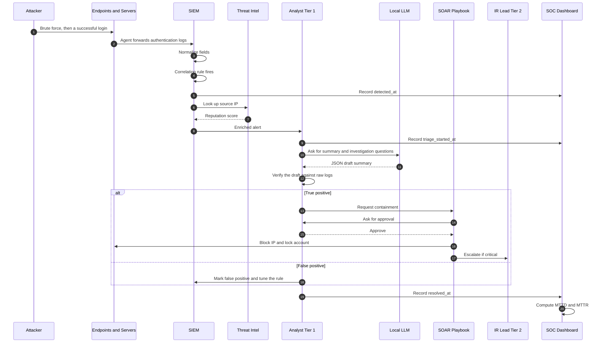
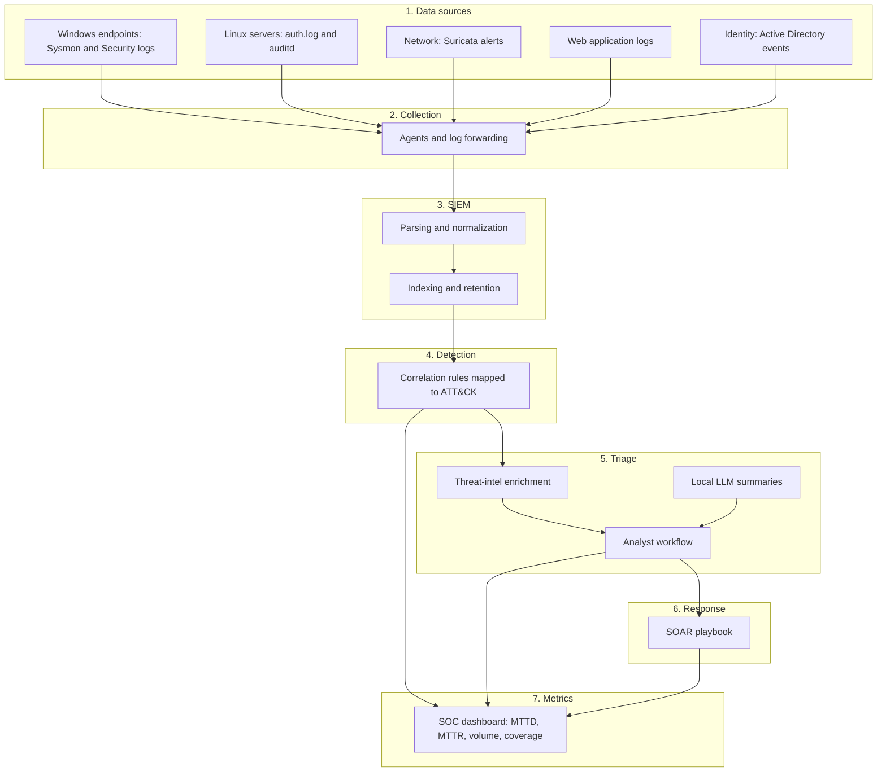
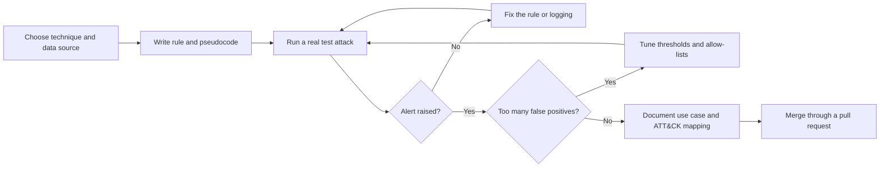
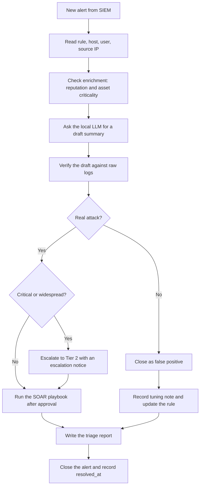
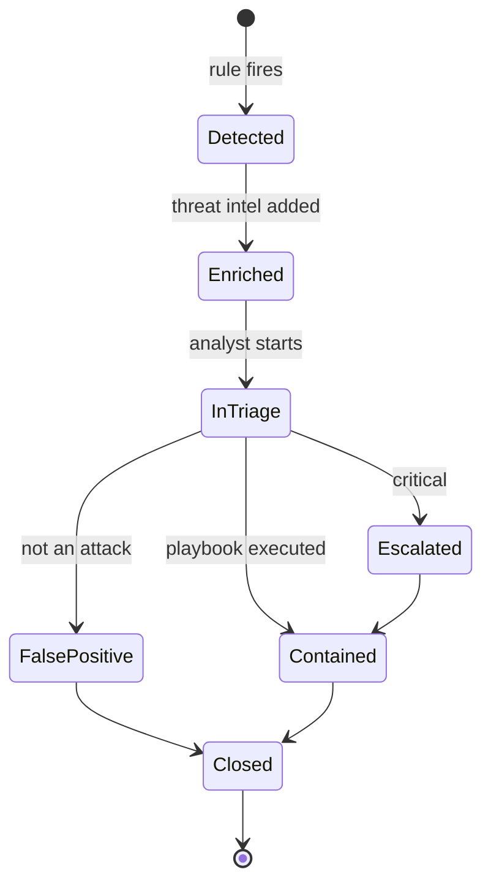
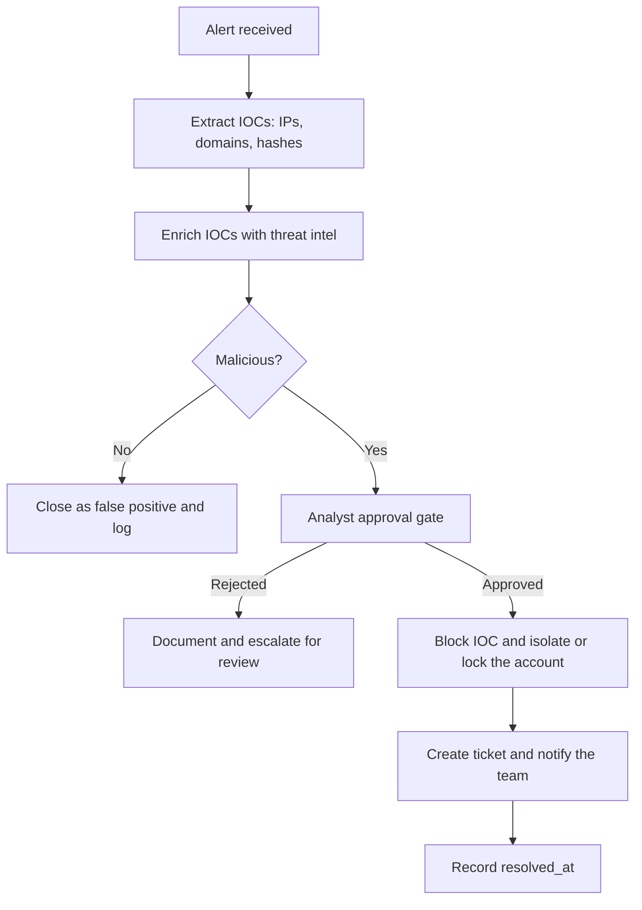
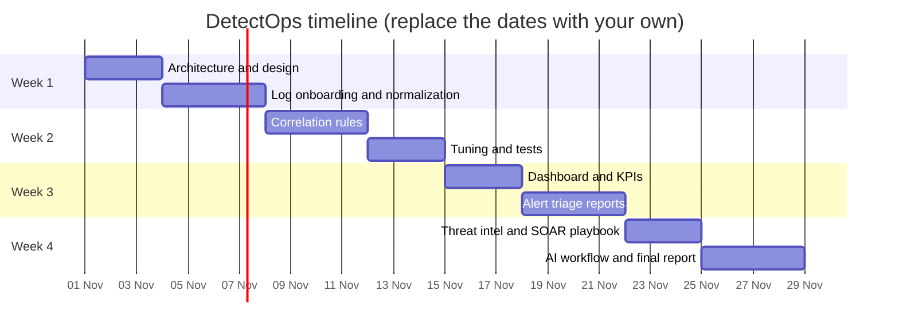
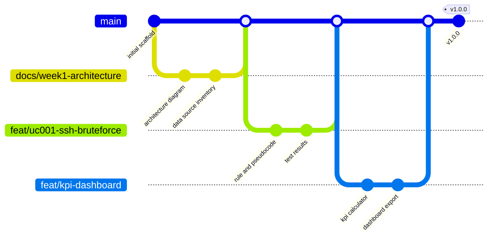

<div align="center">

# DetectOps

### SIEM detection engineering, alert triage and SOC operations lab

**Collect. Detect. Triage. Respond. Measure.**


</div>

> Graduation project for the **Cyber Security Incident Response Analyst** track.
> Educational lab project: every attack runs in an isolated environment we own.

---

## Table of Contents

- [What is DetectOps?](#what-is-detectops)
- [The Problem and the Solution](#the-problem-and-the-solution)
- [End-to-end flow: who does what, in order](#end-to-end-flow-who-does-what-in-order)
- [Architecture](#architecture)
- [Detection engineering](#detection-engineering)
- [Alert triage workflow](#alert-triage-workflow)
- [Alert lifecycle and KPIs](#alert-lifecycle-and-kpis)
- [Threat intelligence enrichment](#threat-intelligence-enrichment)
- [SOAR playbook](#soar-playbook)
- [AI-assisted triage](#ai-assisted-triage)
- [Four-week plan](#four-week-plan)
- [Roles and handoffs](#roles-and-handoffs)
- [Git workflow and branches](#git-workflow-and-branches)
- [Repository structure](#repository-structure)
- [Tech stack and requirements](#tech-stack-and-requirements)
- [Risks and mitigations](#risks-and-mitigations)
- [Results](#results)
- [Team](#team)

---

## What is DetectOps?

**DetectOps is a small, complete SOC built around a SIEM.** It collects logs from
different systems, detects attacks with correlation rules we write and test,
helps analysts investigate alerts, and measures how well the SOC performs.

We design it for a **medium-sized organization** (reference scenario: about 200
users, Windows Active Directory, Linux servers and a web application) and
implement a scaled-down version in the lab.

### In 30 seconds

1. An attacker brute-forces a server and eventually **logs in successfully**.
2. Agents send the authentication logs to the **SIEM**, which normalizes them.
3. A **correlation rule** spots the pattern: many failures followed by a success from the same source.
4. The SIEM raises an alert, records the **detection time**, and enriches it with **threat intelligence**.
5. The **analyst** investigates with a structured workflow; a local AI drafts a summary that the analyst verifies.
6. A **SOAR playbook** contains the threat after the analyst approves.
7. The **dashboard** computes **MTTD** and **MTTR** from the recorded timestamps.

## The Problem and the Solution

| Common problem | What DetectOps does about it |
|---|---|
| Logs are scattered across systems and formats | Onboards and normalizes logs from endpoints, network, identity and applications |
| Detection rules are noisy or untested | Writes correlation rules and tunes them against real test attacks |
| Nobody knows what the SOC can actually detect | Maps every rule to MITRE ATT&CK and publishes a coverage map |
| Investigations are inconsistent | Uses one structured triage workflow with threat-intel enrichment |
| Response is manual and slow | Provides a SOAR playbook with approval gates |
| SOC performance is guesswork | Measures MTTD, MTTR, alert volume and closure rate on a dashboard |

---

## End-to-end flow: who does what, in order

**Scenario: brute force followed by a successful login (ATT&CK T1110, T1078)**



### The same flow as a step table

| # | Who acts | What happens | Who receives or responds | Evidence / timestamp |
|---|---|---|---|---|
| 1 | Attacker | Brute-forces a server, then logs in | Endpoint / server | `attack_start` (from the attack log) |
| 2 | Agent | Forwards logs to the SIEM | SIEM | Log onboarding evidence |
| 3 | SIEM | Normalizes events into common fields | Correlation engine | Field mapping |
| 4 | Correlation engine | Rule matches the pattern, raises an alert | Dashboard + analyst queue | `detected_at` |
| 5 | SIEM | Looks up the source IP | Threat-intel source answers with a score | Enrichment record |
| 6 | Analyst (Tier 1) | Opens the alert, starts triage | Dashboard records it | `triage_started_at` |
| 7 | Analyst | Asks the local LLM for a summary | LLM returns a JSON draft | AI output logged |
| 8 | Analyst | Verifies the draft against raw logs, decides TP or FP | - | Triage report |
| 9a | Analyst | **If TP:** requests containment through the playbook | SOAR asks the analyst to approve | Approval record |
| 9b | SOAR | Executes approved steps (block IP, lock account) | Endpoint / firewall | Action log |
| 9c | Analyst | **If FP:** documents it and tunes the rule | SIEM rule updated | Tuning notes |
| 10 | Analyst | Escalates to Tier 2 if critical | IR lead | Escalation notice |
| 11 | Analyst | Closes the alert | Dashboard | `resolved_at` |
| 12 | Dashboard | Computes MTTD and MTTR | Whole team | KPI values |

---

## Architecture



| Layer | Component | Purpose |
|---|---|---|
| Sources | Endpoints, servers, network, apps, identity | What we monitor |
| Collection | Wazuh agents, Sysmon, auditd, Suricata | Gets events to the SIEM |
| SIEM | Wazuh (or ELK / Splunk Free), single node in the lab | Normalize, store, search |
| Detection | Correlation rules (threshold, sequence, behavioral) | Turn events into alerts |
| Triage | Enrichment, analyst workflow, local LLM | Decide if an alert is real |
| Response | SOAR playbook (n8n, Shuffle or Python) | Contain with approval gates |
| Metrics | Dashboard and KPI calculator | Prove performance with numbers |

Production would use a clustered SIEM; the lab uses a single node and documents what was simplified.

---

## Detection engineering

### Detection lifecycle



### Use cases

| ID | Scenario | ATT&CK | Logic type | Data source |
|---|---|---|---|---|
| UC-001 | SSH or RDP brute force | T1110 | Threshold | Linux auth.log, Windows 4625 |
| UC-002 | Suspicious login: many failures, then success | T1110, T1078 | Sequence | auth.log, Windows 4624 and 4625 |
| UC-003 | Lateral movement over SMB or RDP | T1021 | Behavioral | Windows 4624 (type 3 or 10), Sysmon |
| UC-004 | Persistence through scheduled task or run key | T1053, T1547 | Behavioral | Sysmon, Windows 4698 |
| UC-005 | Data exfiltration: large outbound transfer | T1048 | Threshold | Suricata, network logs |

### Example pseudocode (UC-002)

```text
FOR each source_ip:
    IF count(failed_login) >= 8 WITHIN 120 seconds
       AND a successful_login follows from the same source_ip WITHIN 300 seconds
    THEN raise alert(severity = high, technique = T1110 + T1078)
```

Every rule ships with: ATT&CK mapping, pseudocode, a test attack, the observed result, and tuning notes.

---

## Alert triage workflow



**Triage checklist:** what fired and why, which asset and user, source reputation, did any login
succeed, what else did the source do, verdict and rationale, action taken, timestamps.

## Alert lifecycle and KPIs



| KPI | Definition | Formula | Timestamps used |
|---|---|---|---|
| MTTD | Mean time to detect | mean(`detected_at` - `attack_start`) | attack log, SIEM |
| MTTR | Mean time to respond | mean(`resolved_at` - `detected_at`) | SIEM, dashboard |
| Alert volume | Alerts per day and per rule | count(alerts) | SIEM |
| Closure rate | Closed alerts over total | closed / total | dashboard |
| False-positive rate | False positives over triaged alerts | fp / triaged | triage reports |
| Top attackers and targets | Most frequent source IPs and hosts | group by | SIEM |

All timestamps are UTC and **recorded, never estimated**.

## Threat intelligence enrichment

| Source | Used for |
|---|---|
| AbuseIPDB (free tier) | IP reputation score |
| AlienVault OTX | Known indicators and pulses |
| Asset inventory | Criticality of the target host |

Enrichment results are attached to the alert and summarized in the TI enrichment report.

## SOAR playbook

Playbook scope: **phishing or malware response**. Sensitive steps need analyst approval.



| # | Step | Automated or manual | Approval needed |
|---|---|---|---|
| 1 | Receive alert | Automated | No |
| 2 | Extract IOCs | Automated | No |
| 3 | Enrich with threat intel | Automated | No |
| 4 | Decide malicious or not | Manual (analyst) | - |
| 5 | Block IOC, isolate or lock account | Automated after approval | **Yes** |
| 6 | Create ticket and notify | Automated | No |

## AI-assisted triage

A local LLM (Ollama) drafts summaries and investigation questions. The analyst always verifies.

```json
{
  "alert_summary": "...",
  "likely_cause": "...",
  "investigation_questions": ["..."],
  "next_steps": ["..."],
  "escalate": true,
  "mitre_technique": "T1021"
}
```

**Guardrails**

- AI summaries assist the analyst and never close an alert on their own.
- MTTD and MTTR come from recorded timestamps, not estimates.
- Any playbook step that affects a real system requires human approval.
- Wrong or invented claims are recorded in a validation log.
- Everything runs locally; no logs or secrets leave the lab.

---

## Four-week plan



| Week | Focus | Tasks | Deliverables |
|---|---|---|---|
| 1 | Architecture and log onboarding | Design the SIEM for a medium organization; identify sources (endpoints, network, identity, cloud, applications); configure log forwarding and normalization | Architecture diagram, data source inventory, onboarding evidence, normalized field mapping, retention plan |
| 2 | Correlation rules | Rules for brute force, suspicious login, lateral movement, persistence and exfiltration using threshold, sequence and behavioral logic; reduce false positives and negatives | 5 to 10 rules, use-case document, tuning notes, pseudocode, test results |
| 3 | Dashboards and alert triage | Dashboard with MTTD, MTTR, alert volume, closure rate, top attackers and targets; structured triage with enrichment | Dashboard screenshots, KPI definitions, 3+ triage reports, escalation communication, TI enrichment |
| 4 | Threat intel, SOAR and AI | IOC enrichment and ATT&CK mapping; SOAR playbook for phishing or malware; local LLM summaries | TI enrichment report, MITRE coverage map, SOAR playbook, AI-assisted triage workflow, final SOC operations report |

## Roles and handoffs

| Role | Owns | Hands off to |
|---|---|---|
| SIEM / Infrastructure Engineer | SIEM deployment, agents, log onboarding, retention | Detection Engineer (normalized, searchable logs) |
| Detection Engineer | Correlation rules, tuning, test results | Dashboard and Triage (working alerts) |
| Dashboard and Metrics | KPIs, dashboard, timestamp recording | Everyone (measured results) |
| Threat Intel / SOAR / AI | Enrichment, playbook, LLM workflow | Analyst (enriched alerts, summaries, playbook) |
| Incident Response and Reporting | Triage reports, escalation, final report | Instructor / reviewers |

Every deliverable has one owner and one reviewer, tracked in the table below.

---

## Git workflow and branches

We use a simple **trunk-based workflow**: `main` is always working and protected; all
changes arrive through short-lived branches and pull requests.



**Rules**

- No direct pushes to `main`. Every change goes through a pull request with **one reviewer**.
- Branch names: `feat/<name>`, `docs/<name>`, `fix/<name>`, `test/<name>`. Lowercase, hyphens, short.
- Commit messages follow Conventional Commits: `feat: add UC-002 sequence rule`, `docs: add week 2 tuning notes`.
- Delete the branch after the squash-merge.
- Tag the final submission as `v1.0.0`.

**Branch plan (create each branch when its work starts)**

| Week | Branch | Owner role | Content |
|---|---|---|---|
| 1 | `docs/week1-architecture` | SIEM / Infra | Architecture diagram, inventory, retention plan |
| 1 | `feat/log-onboarding` | SIEM / Infra | Agent configs, field mapping, onboarding evidence |
| 2 | `feat/uc001-ssh-bruteforce` | Detection | Rule, pseudocode, test, tuning |
| 2 | `feat/uc002-suspicious-login` | Detection | Sequence rule and test |
| 2 | `feat/uc003-uc005-rules` | Detection | Lateral movement, persistence, exfiltration |
| 3 | `feat/kpi-dashboard` | Dashboard | KPI calculator, dashboard export, screenshots |
| 3 | `docs/triage-reports` | IR / Reporting | 3+ triage reports and escalation notice |
| 4 | `feat/threat-intel-enrichment` | Threat Intel / SOAR / AI | Enrichment script and report |
| 4 | `feat/soar-playbook` | Threat Intel / SOAR / AI | Playbook and test results |
| 4 | `feat/ai-triage-workflow` | Threat Intel / SOAR / AI | Prompts, validation log |
| 4 | `docs/final-report` | IR / Reporting | Final SOC operations report |

**Creating a branch on GitHub:** open the branch dropdown (shows `main`), type the new
branch name, and choose **Create branch**. Then edit or upload files on that branch and open
a pull request.

**Also set up:** branch protection on `main` (require a pull request and one approval),
labels (`task`, `bug`, `week-1` to `week-4`), one milestone per week, and an issue for every deliverable.

## Repository structure

> The repository starts minimal and grows week by week.

```text
docs/          architecture, data sources, field mapping, retention, KPIs, weekly notes
infra/         SIEM and agent configuration
detection/     correlation rules, use cases, test matrix
dashboards/    exported dashboards and screenshots
triage/        triage workflow, templates, completed reports
threat-intel/  enrichment scripts and report
soar/          playbooks and automation flows
ai-assisted/   prompts, workflow, validation log
mitre/         ATT&CK coverage map
reports/       final SOC operations report
```

## Tech stack and requirements

`Wazuh` or `ELK` or `Splunk Free` · `Sysmon` · `Suricata` · `Sigma` · `Atomic Red Team` ·
`n8n` or `Shuffle` or `Python` · `Ollama` · `MITRE ATT&CK Navigator` · `AbuseIPDB` · `AlienVault OTX`

| Item | Guideline |
|---|---|
| SIEM host | roughly 8 GB RAM for a small lab; a 16 GB machine is preferred |
| Other roles | 8 GB machines are enough |
| Splunk Free | has usage limits; Wazuh or ELK are alternatives |
| Cost | all tools used are free |

## Risks and mitigations

| Risk | Mitigation |
|---|---|
| The SIEM is too heavy for the lab | Single node on a 16 GB machine with a small number of agents |
| Splunk Free limits get in the way | Use Wazuh or ELK |
| Not enough attack data for rules | Atomic Red Team tests and public datasets |
| Alert noise hides real attacks | Tuning loop and allow-lists, tracked in the false-positive rate |
| AI output is wrong | Analyst verification, validation log, AI never closes alerts |

## Results

> Filled in at the end of the project from real measurements.

| Metric | Result |
|---|---|
| Data sources onboarded | _TBD_ |
| Correlation rules / ATT&CK techniques covered | _TBD_ |
| Attacks detected in testing | _TBD_ |
| MTTD / MTTR | _TBD_ |

## Deliverables tracker

| Week | Deliverable | Owner | Status |
|---|---|---|---|
| 1 | Architecture diagram |  | ⬜ |
| 1 | Data source inventory |  | ⬜ |
| 1 | Log onboarding evidence |  | ⬜ |
| 1 | Normalized field mapping |  | ⬜ |
| 1 | Retention plan |  | ⬜ |
| 2 | 5 to 10 correlation rules |  | ⬜ |
| 2 | Use-case document |  | ⬜ |
| 2 | Tuning notes |  | ⬜ |
| 2 | Rule pseudocode |  | ⬜ |
| 2 | Test results |  | ⬜ |
| 3 | Dashboard screenshots |  | ⬜ |
| 3 | KPI definitions |  | ⬜ |
| 3 | Triage reports (3+) |  | ⬜ |
| 3 | Escalation communication |  | ⬜ |
| 3 | Threat intel enrichment |  | ⬜ |
| 4 | TI enrichment report |  | ⬜ |
| 4 | MITRE coverage map |  | ⬜ |
| 4 | SOAR playbook |  | ⬜ |
| 4 | AI-assisted triage workflow |  | ⬜ |
| 4 | Final SOC operations report |  | ⬜ |

## Team

| Name | Role | GitHub |
|---|---|---|
|  | SIEM / Infrastructure Engineer |  |
|  | Detection Engineer |  |
|  | Dashboard and Metrics |  |
|  | Threat Intel / SOAR / AI |  |
|  | Incident Response and Reporting |  |

## Disclaimer

For educational use in isolated lab environments only. Do not run any attack
technique against systems you do not own.

## License

Released under the [MIT License](LICENSE).
